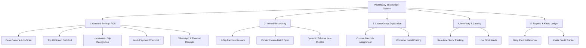

# PackReady Shopkeeper Edition — Functional Flow & Business Logic Specification

> **Document Type:** Universal Product & Process Flow Specification  
> **Target Audience:** Product Managers, System Architects, Mobile/Backend Developers (Any Platform)  
> **Scope:** Complete end-to-end retail workflows, functional specifications, data models, and edge-case handling.  
> **Platform Independence:** Strictly agnostic of underlying technologies, frameworks, and programming languages.

---

## 1. Executive Product Overview

**PackReady Shopkeeper Edition** is an offline-first mobile point-of-sale (POS) and smart inventory management system designed for neighborhood retail stores, convenience stores, and kirana shops. 

It eliminates traditional retail friction by enabling:
1. **Hands-Free Checkout**: Place the mobile device on a desk mount to continuously scan barcodes as products pass underneath.
2. **Dual-Speed Inward Restocking**: Instant 1-tap barcode scanning for individual items and batch table recognition from distributor paper invoices.
3. **Loose Goods Digitization**: Generation and printing of custom container stickers for unbranded, loose staples (e.g., rice, lentils, sugar).
4. **Handwritten Customer Slip Digitization**: Automatic conversion of handwritten grocery lists into live checkout carts.
5. **Zero-Overhead Ledger & Multi-Payment POS**: Seamless split between Cash (with change return calculation), Dynamic UPI QR payments, and Khata (credit ledger).

---

## 2. Core Functional Workflows



---

## 3. Workflow 1: Outward POS & Checkout Flow (Selling)

### 3.1 Hands-Free Desk Camera Scanning
```
[Customer brings items] 
         ↓
[Shopkeeper places device on desk stand] 
         ↓
[Camera continuously monitors scanner reticle]
         ↓
[Product passes through camera frame]
         ↓
[Barcode Detected & Validated]
    ├── Found in Store Catalog:
    │     └── Play Success Chime + Vibrate + Add +1 Qty to Cart + Flash Toast
    └── Not Found in Store Catalog:
          └── Fallback to Global Catalog Lookup:
                ├── Found: Auto-register item into store catalog + Add to Cart
                └── Not Found: Trigger Warning Audio + Prompt Quick-Add
```

**Key Business Rules:**
- **Scan Debounce Window:** Once a barcode is read, ignore identical scans for **1,400 milliseconds** to prevent duplicate additions when holding an item in front of the lens.
- **Continuous Viewport:** The camera runs continuously without requiring a button press per item.
- **Hardware Controls:** Digital zoom slider (1.0x to 4.0x) and flashlight torch toggle available directly on screen for low-light conditions.
- **Screen Wake-Lock:** The device display remains active indefinitely during checkout mode without dimming or locking.

---

### 3.2 High-Velocity Speed Dial Grid (Top 20 Items)
- The system dynamically maintains a ranked list of the **top 20 most frequently sold items**.
- Displayed as large, tactile touch cards directly below the scanner.
- Tapping any tile triggers an immediate haptic pulse, plays an addition chime, and increments that product’s quantity in the active cart by +1.

---

### 3.3 Handwritten Customer Slip Processing
```
[Customer hands over a handwritten grocery paper list]
         ↓
[Shopkeeper taps 'Scan Slip' & takes a photo]
         ↓
[Text Extraction Engine parses lines & quantities]
    e.g., "2 kg Sugar", "3 Maggi", "1 Dove Soap"
         ↓
[Fuzzy Matching against Store Inventory Catalog]
         ↓
[Reconciliation Screen Displays Matched vs Unmatched Items]
         ↓
[Shopkeeper reviews quantities & taps 'Add All to Cart']
         ↓
[Cart immediately populated with all matched items]
```

---

### 3.4 Active Cart & Stepper Management
- **Floating Cart Indicator:** Displays total item count, distinct products count, and grand total.
- **Bottom Sheet Drawer:** Pulling up the drawer reveals the full itemized bill.
- **Real-Time Steppers:** Quick `+` and `-` controls per line item. Reducing quantity below 1 removes the item from the bill.
- **Discount Support:** Allows fixed amount or percentage discount deductions from the subtotal.

---

### 3.5 Payment Methods & Checkout Finalization

```
[Tap 'Proceed to Pay']
         ↓
[Select Payment Method]
    ├── CASH:
    │     ├── Input Cash Received
    │     └── System calculates 'Change to Return'
    ├── UPI QR CODE:
    │     └── Dynamically renders QR containing Merchant UPI VPA + Exact Bill Amount
    └── KHATA (Credit/Udhar):
          └── Records total amount against Customer Name / Phone
         ↓
[Confirm Sale]
         ↓
[Inventory Deducted Instantly + Success Audio + Confetti]
         ↓
[Output Actions]
    ├── Thermal Print: Generates formatted receipt for 58mm/80mm printer
    ├── WhatsApp Receipt: Generates pre-filled message link to customer's phone
    └── Start Next Customer
```

---

## 4. Workflow 2: Inward Stocking & Procurement

### 4.1 1-Tap Barcode Restock
```
[New stock arrives at store]
         ↓
[Shopkeeper scans barcode of arriving carton/pack]
         ↓
[System fetches existing product information]
         ↓
[Interface displays Current Stock, Cost Rate, Selling Price]
         ↓
[Shopkeeper updates Quantity Received (e.g., +24)]
         ↓
[Optional: Updates Wholesale Cost & Retail Price]
         ↓
[Tap 'Add to Inventory'] → Stock updated & restock timestamp logged
```

---

### 4.2 Vendor / Distributor Purchase Invoice OCR
```
[Shopkeeper receives printed tax invoice from distributor]
         ↓
[Takes photo of paper invoice]
         ↓
[OCR Vision Engine extracts tabular data]
    ├── Vendor Name, Invoice Number, Invoice Date
    └── Line Items (Item Description, Quantity, Rate, Total)
         ↓
[Catalog Reconciliation Matrix]
    ├── Matched Items: Auto-linked to existing catalog products
    └── Unmatched Items: Highlighted with option to create new product
         ↓
[Shopkeeper toggles checkboxes to confirm items & edits quantities]
         ↓
[Tap 'Add to Stock'] → All confirmed items bulk-increment inventory simultaneously
```

---

### 4.3 Custom Product Creation with Dynamic Category Schema
When adding products not found in standard catalogs, the system prompts for category-specific attributes:

| Category | Specialized Attribute Fields |
| :--- | :--- |
| **Food & Grocery** | Net Weight / Volume (g, kg, ml, L), Food Classification (Vegetarian / Non-Veg), Best Before (Months) |
| **Beverages** | Volume (ml, L), Packaging Type (Can, Bottle, Tetra), Best Before |
| **Electronics & Electrical** | Wattage (W), Voltage Range (V), Warranty Duration (Months), Pin/Cap Type (B22, E27, Type-C) |
| **Personal Care & Hygiene** | Net Volume / Weight, Variant / Fragrance (e.g., Lemon, Menthol, Aloe) |
| **Household & Cleaning** | Volume / Weight, Form (Liquid, Powder, Bar), Fragrance |
| **Apparel & Footwear** | Size (S, M, L, XL, 32, 34), Color, Fabric Composition |
| **Loose Staples** | Grain Grade / Quality (Superfine, Desi, Raw, Boiled), Origin |
| **OTC & Wellness** | Dosage Form (Tablet, Syrup), Pack Size, Storage Conditions |

---

## 5. Workflow 3: Loose Staples & Custom Barcodes

For unbranded goods sold from open sacks or containers (Rice, Sugar, Lentils, Spices, Grains):

```
[Shopkeeper enters Item Name, Price, and Unit (kg/litre)]
         ↓
[System generates unique internal identifier: PK-LOOSE-XXXX]
         ↓
[System renders printable Barcode Label]
         ↓
[Select Label Sheet Copies (2, 4, 6, 12, 24)]
         ↓
[Print Sticker Sheet on standard thermal or sticker paper]
         ↓
[Shopkeeper sticks label onto bulk jar / container]
         ↓
[During checkout: Camera instantly scans container label at desk POS]
```

---

## 6. Workflow 4: Inventory Management & Alerts

### 6.1 Stock Level Tracking
- **Outward Selling:** Stock decrements immediately upon transaction completion.
- **Inward Restock:** Stock increments immediately upon inward scan or invoice sync.
- **Manual Adjustment:** In-catalog quick steppers (`+` / `-`) for manual write-offs, damages, or spot adjustments.

### 6.2 Low-Stock Thresholds
- Every product has a configurable `minStockAlert` value (default: 5 units).
- When `currentStock <= minStockAlert`, a **Low Stock Indicator** appears on the header bar and inventory catalog.
- Low-stock items are grouped for fast re-ordering from distributors.

---

## 7. Workflow 5: Analytics, Revenue & Khata Ledger

### 7.1 Daily Metrics Dashboard
- **Total Revenue:** Gross sales aggregate for the current calendar day.
- **Estimated Gross Profit:** Calculated dynamically as `Sum((Selling Price - Cost Price) * Quantity Sold)`.
- **Profit Margin (%):** Computed as `(Total Profit / Total Revenue) * 100`.
- **Payment Breakdown:** Split between Cash Revenue, UPI Digital Revenue, and Khata Credit Revenue.

### 7.2 Khata / Udhar Customer Ledger
- Tracks credit given to trusted local customers.
- Logs customer name, phone number, outstanding amount, and timestamp.
- Allows 1-tap settlement when the customer clears dues.

### 7.3 Transaction History & Receipts
- Chronological feed of all completed sales.
- Searchable by invoice number, customer name, or payment method.
- **Actions per Transaction:**
  - Re-print thermal receipt.
  - Re-send digital receipt link via WhatsApp.

---

## 8. Conceptual Data Models (Platform-Agnostic)

### 8.1 Product Entity
```json
{
  "id": "String (Unique Product ID or Barcode)",
  "barcode": "String (EAN-13, UPC, or PK-LOOSE-XXXX)",
  "name": "String (Product Full Display Name)",
  "brand": "String (Brand or Manufacturer)",
  "category": "Enum (food_grocery, beverages, personal_care, household_cleaning, electronics_electric, apparel_footwear, stationery_craft, loose_staples, medicine_wellness)",
  "subCategory": "String (e.g., Biscuits, LED Bulbs)",
  "mrp": "Decimal (Maximum Retail Price)",
  "costPrice": "Decimal (Purchase / Wholesale Rate)",
  "sellingPrice": "Decimal (Actual In-Store Selling Price)",
  "currentStock": "Integer / Decimal (Units in store)",
  "minStockAlert": "Integer / Decimal (Threshold for low-stock warning)",
  "unit": "Enum (pcs, kg, g, litre, ml, pack, box, dozen)",
  "gstPercent": "Decimal (Tax rate percentage: 0, 5, 12, 18, 28)",
  "salesCount": "Integer (Lifetime units sold for popularity ranking)",
  "attributes": "Dynamic Category Object (Refer to 4.3)",
  "lastRestockedAt": "Timestamp",
  "createdAt": "Timestamp",
  "updatedAt": "Timestamp"
}
```

### 8.2 Sale Transaction Entity
```json
{
  "id": "String (Unique Transaction ID)",
  "invoiceNumber": "String (Sequential: INV-YYYYMMDD-XXXX)",
  "items": [
    {
      "productId": "String",
      "name": "String",
      "barcode": "String",
      "quantity": "Decimal",
      "unitPrice": "Decimal",
      "costPrice": "Decimal",
      "discount": "Decimal",
      "total": "Decimal"
    }
  ],
  "subtotal": "Decimal",
  "discount": "Decimal",
  "taxAmount": "Decimal",
  "grandTotal": "Decimal",
  "paymentMethod": "Enum (cash, upi, credit_khata, card)",
  "paymentDetails": {
    "cashReceived": "Decimal",
    "changeReturned": "Decimal",
    "upiTransactionId": "String (Optional)"
  },
  "customerName": "String (Optional)",
  "customerPhone": "String (Optional)",
  "timestamp": "Timestamp"
}
```

### 8.3 Vendor Invoice Reconciliation Entity
```json
{
  "id": "String",
  "vendorName": "String",
  "invoiceNumber": "String",
  "invoiceDate": "String",
  "totalAmount": "Decimal",
  "items": [
    {
      "id": "String",
      "rawExtractedText": "String",
      "matchedProductId": "String (Optional)",
      "matchedProductName": "String",
      "barcode": "String (Optional)",
      "quantity": "Decimal",
      "purchaseRate": "Decimal",
      "sellingPrice": "Decimal",
      "totalAmount": "Decimal",
      "isConfirmed": "Boolean"
    }
  ],
  "status": "Enum (draft, processed, reconciled)",
  "createdAt": "Timestamp"
}
```

---

## 9. Hardware & Sensory UX Specifications

1. **Auditory Feedback (Audio Synthesizer):**
   - **Barcode Success Scan:** Crisp high-frequency laser chime (1,760 Hz to 2,640 Hz, 80ms duration).
   - **Sale Completed:** Cash register bell chime (520 Hz / 880 Hz harmonic, 400ms duration).
   - **Warning / Unmatched Item:** Low-pitch double buzz (220 Hz, 150ms duration).
2. **Tactile Haptic Feedback (Vibration Actuator):**
   - **Product Added:** Single light vibration pulse (15ms).
   - **Sale Success:** Heavy double pulse confirmation (50ms - pause - 70ms).
   - **Scan Error / Warning:** Triple sharp pulse pattern.
3. **Desk Kiosk Ergonomics:**
   - Single-hand bottom drawer interaction.
   - High contrast light UI with warm minimal visual hierarchy for prolonged store lighting conditions.
